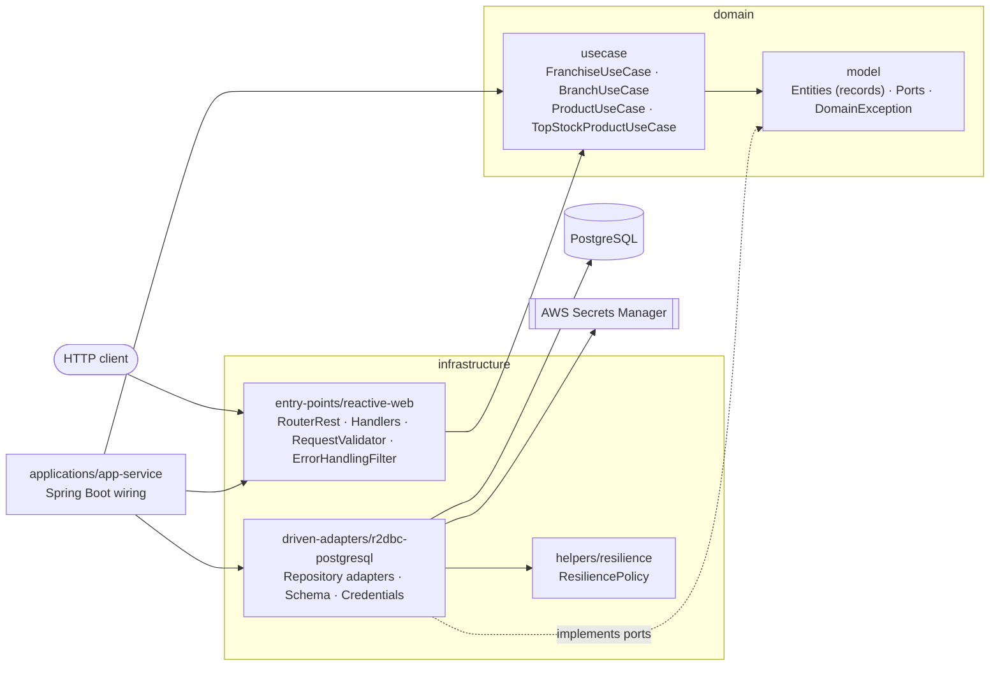
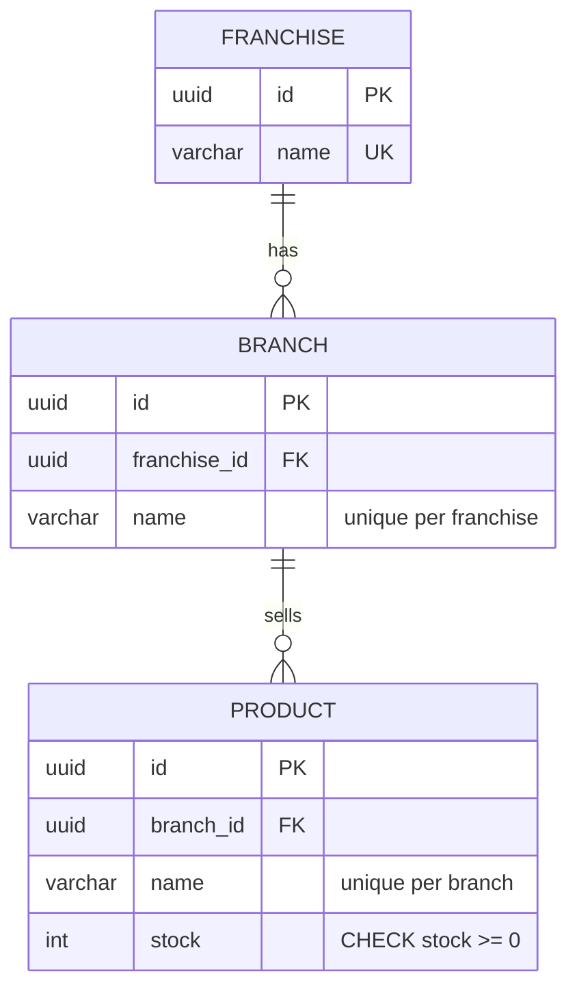
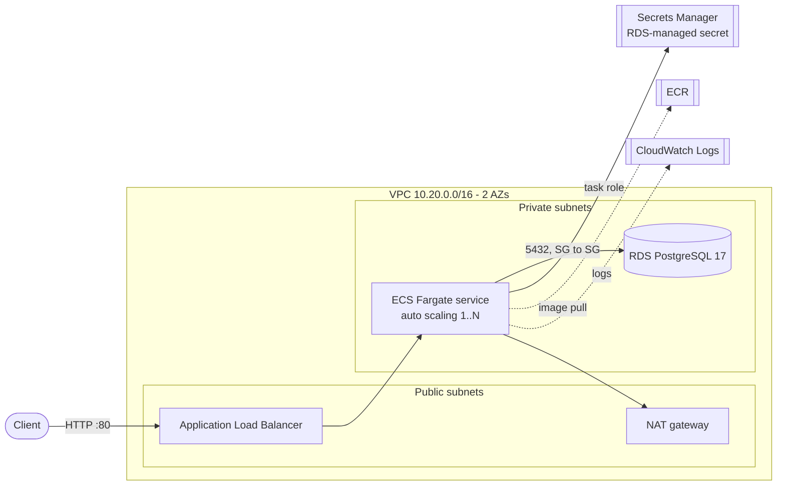

# Franchise API

Reactive REST API to manage a network of franchises, their branches and the stock of the products each branch sells.

Built with **Java 25**, **Spring Boot 4.1 / WebFlux**, **R2DBC + PostgreSQL** and the
[Bancolombia Clean Architecture scaffold](https://bancolombia.github.io/scaffold-clean-architecture/). The flow is
non-blocking end to end, from the HTTP server to the database driver, and the test suite runs with
[BlockHound](https://github.com/reactor/BlockHound) to prove it.

---

## Contents

- [Highlights](#highlights)
- [Architecture](#architecture)
- [API](#api)
- [Getting started](#getting-started)
- [Testing](#testing)
- [Configuration](#configuration)
- [Deployment (AWS)](#deployment-aws)
- [Project structure](#project-structure)
- [Git workflow](#git-workflow)

---

## Highlights

- **Functional endpoints only**: `RouterFunction` + handlers, no `@RestController`. There is no `.block()`, no
  `try/catch` and no `if` inside reactive flows, and no `java.util.stream`.
- **Hexagonal architecture**: business rules live in the domain (`model` + `usecase`). Persistence and HTTP are
  adapters behind ports. The scaffold's `validateStructure` and ArchUnit rules enforce the dependency rule.
- **Consistency under concurrency**: every update touches a single column (`UPDATE ... RETURNING`), so there are no
  lost updates. Unique constraints back the "unique name per parent" rule even when two requests race.
- **Resilience**: timeout, circuit breaker and retry with exponential backoff (Resilience4j). Only idempotent operations
  are retried.
- **Secrets**: database credentials are read from AWS Secrets Manager reactively, once per new physical connection, so
  a rotated password is picked up without a restart. Nothing sensitive is stored in code or environment variables.
- **Errors as [RFC 9457](https://www.rfc-editor.org/rfc/rfc9457) problem details** (`application/problem+json`), with a
  stable error `code`.
- **137 tests, 99% line coverage**: unit (StepVerifier + Mockito), adapter integration and end-to-end tests against a
  real PostgreSQL (Testcontainers). `./gradlew check` fails if any module drops below 80% line coverage.

## Architecture



| Module | Layer | Responsibility |
|---|---|---|
| `domain/model` | Domain | Entities as immutable records built with Lombok `@Builder(toBuilder = true)`, repository ports, the sealed `DomainException` hierarchy and the `TechnicalMessage` catalogue. |
| `domain/usecase` | Domain | Business rules, written as reactive pipelines over the ports. |
| `infrastructure/entry-points/reactive-web` | Infrastructure | Routes, handlers, request records and validation, error translation, OpenAPI. |
| `infrastructure/driven-adapters/r2dbc-postgresql` | Infrastructure | R2DBC adapters, SQL schema, connection pool, Secrets Manager credentials. |
| `infrastructure/helpers/resilience` | Infrastructure | Timeout, circuit breaker and retry policies. |
| `applications/app-service` | Application | Spring Boot main class, configuration and wiring. |

### Data model



## API

Base path: `/api/v1`. Swagger UI is available at **`/swagger-ui.html`**, and the OpenAPI document at `/v3/api-docs`.
Every operation is documented there with request and response examples.

| # | Operation | Method & path | Success |
|---|---|---|---|
| 1 | Create a franchise | `POST /franchises` | `201` |
| 2 | Add a branch to a franchise | `POST /franchises/{franchiseId}/branches` | `201` |
| 3 | Add a product to a branch | `POST /franchises/{franchiseId}/branches/{branchId}/products` | `201` |
| 4 | Remove a product from a branch | `DELETE /franchises/{franchiseId}/branches/{branchId}/products/{productId}` | `204` |
| 5 | Set the stock of a product | `PUT /franchises/{franchiseId}/branches/{branchId}/products/{productId}/stock` | `200` |
| 6 | Product with the highest stock per branch | `GET /franchises/{franchiseId}/top-stock-products` | `200` |
| 7 | Rename a franchise | `PUT /franchises/{franchiseId}/name` | `200` |
| 8 | Rename a branch | `PUT /franchises/{franchiseId}/branches/{branchId}/name` | `200` |
| 9 | Rename a product | `PUT /franchises/{franchiseId}/branches/{branchId}/products/{productId}/name` | `200` |

Rules enforced by the domain:

- Names are required, at most 100 characters, and unique within their parent: franchise names are globally unique,
  branch names within a franchise, product names within a branch.
- Stock is an absolute value and must be zero or greater.
- Resources are addressed through their hierarchy. A product is only reachable through its own branch and franchise;
  otherwise the API answers `404`.
- `PUT` operations are idempotent. Renaming to the current name succeeds, and setting the same stock twice gives the
  same result.
- In `top-stock-products`, branches without products are omitted, and stock ties are broken by product name.

### Errors

Errors follow RFC 9457 and add a stable `code` and, for validation errors, the list of violated fields:

```json
{
  "title": "Bad Request",
  "status": 400,
  "detail": "The request is invalid, please verify the data",
  "instance": "/api/v1/franchises/.../products",
  "code": "FRN-400",
  "timestamp": "2026-10-09T01:41:50.001Z",
  "errors": [
    { "field": "name", "message": "must not be blank" },
    { "field": "stock", "message": "must be greater than or equal to 0" }
  ]
}
```

| HTTP | Codes | When |
|---|---|---|
| 400 | `FRN-400`, `FRN-401`, `FRN-402` | Malformed body or identifier, constraint violations, invalid name or stock |
| 404 | `FRN-404`, `FRN-405`, `FRN-406` | Franchise, branch or product not found in the given hierarchy |
| 409 | `FRN-409`, `FRN-410`, `FRN-411` | Name already taken in the parent |
| 503 | `FRN-503` | Database unavailable, timed out, or circuit open (safe to retry later) |
| 500 | `FRN-500` | Unexpected error; no internal details are exposed |

## Getting started

### Prerequisites

- **Option 1** needs only Docker (with Compose) or Podman (with a compose provider such as `podman-compose`).
- **Option 2** needs **JDK 25** plus Docker/Podman to run PostgreSQL. The Gradle wrapper downloads Gradle 9.8.1.

### Option 1: everything in containers

```bash
git clone https://github.com/emmanuelcastig/franchise-api.git
cd franchise-api
docker compose up --build        # or: podman compose up --build
```

The image is built from source (multi-stage `deployment/Dockerfile`). When the API logs `Started MainApplication`, it
is ready at <http://localhost:8080/swagger-ui.html>.

### Option 2: run with Gradle

```bash
# 1. Start PostgreSQL (credentials of a disposable local database)
docker run -d --name franchise-postgres -p 5432:5432 \
  -e POSTGRES_DB=franchise -e POSTGRES_USER=franchise -e POSTGRES_PASSWORD=franchise postgres:17-alpine

# 2. Run the API with the local profile
./gradlew :app-service:bootRun --args='--spring.profiles.active=local'      # Windows: gradlew.bat ...
```

The schema is created automatically on startup.

> If a local PostgreSQL already listens on 5432, publish the container on another port (`-p 5433:5432`) and start the
> API with `DB_PORT=5433`.

### Try it

```bash
BASE=http://localhost:8080/api/v1/franchises

# 1. Create a franchise
curl -s -X POST $BASE -H 'Content-Type: application/json' -d '{"name":"Burger Town"}'
# {"id":"<franchiseId>","name":"Burger Town"}

# 2. Add a branch
curl -s -X POST $BASE/<franchiseId>/branches -H 'Content-Type: application/json' -d '{"name":"Downtown"}'

# 3. Add a product
curl -s -X POST $BASE/<franchiseId>/branches/<branchId>/products \
  -H 'Content-Type: application/json' -d '{"name":"Fries","stock":50}'

# 5. Set the stock
curl -s -X PUT $BASE/<franchiseId>/branches/<branchId>/products/<productId>/stock \
  -H 'Content-Type: application/json' -d '{"stock":120}'

# 6. Top stock product per branch
curl -s $BASE/<franchiseId>/top-stock-products

# 4. Remove a product
curl -s -X DELETE $BASE/<franchiseId>/branches/<branchId>/products/<productId>
```

### Bruno collection

`docs/bruno` contains a [Bruno](https://www.usebruno.com/) collection that exercises the whole API in order:
franchises, branches and products, top stock per branch, and the error cases (`400`, `404`, `409`). Requests pass ids
to each other through variables, and each one carries assertions. Franchise names get a timestamp, so the collection
can be run repeatedly against the same database.

- **Desktop app**: open the `docs/bruno` folder, choose the `local` or `aws` environment, and run the collection.
- **CLI**:

  ```bash
  cd docs/bruno
  npx @usebruno/cli run --env local -r
  ```

The `aws` environment reads the API URL from `docs/bruno/.env` (`FRANCHISE_API_URL`). `iac/scripts/deploy.sh` writes that file, or you can copy `.env.example`.

Health probes: `GET /actuator/health/liveness` and `GET /actuator/health/readiness`. Metrics: `GET /actuator/prometheus`.

## Testing

```bash
./gradlew test                 # every test
./gradlew check                # tests + 80% line coverage gate per module
./gradlew jacocoMergedReport   # merged report: build/reports/jacocoMergedReport/html/index.html
```

| Level | Where | What it proves |
|---|---|---|
| Unit | `domain/model` | Domain rules and contracts: name and stock rules, top-stock ranking with deterministic tie-break, unique error codes, sealed exception hierarchy. Records without behaviour have no tests. |
| Unit | `domain/usecase` | Business scenarios with `StepVerifier` + Mockito: validation, hierarchy, uniqueness, idempotent rename, top-stock ranking, demand-driven streaming with 1,000 branches. |
| Unit | `helpers/resilience`, `r2dbc/commons` | Retries only on transient errors and only for idempotent calls, time limiter cancellation, circuit opening, error translation. |
| Slice | `reactive-web` | `@WebFluxTest` of every route: status codes, problem details, validation, CORS and security headers. |
| Integration | `r2dbc-postgresql` | Adapters against PostgreSQL 17 (Testcontainers): SQL, mappings, constraints, scoping, grouped streaming. |
| End-to-end | `app-service` | The whole service on a random port against PostgreSQL: the full lifecycle of a franchise, OpenAPI document, readiness probe. |
| Architecture | `app-service` | Scaffold ArchUnit rules (final fields, no technology names in the domain). |

Integration and end-to-end tests need a Docker-compatible runtime (Docker or Podman). Without one they are **skipped**,
not failed. No test uses `.block()`.

BlockHound is installed in every test JVM. A blocking call on a non-blocking thread fails the test.

## Configuration

| Variable | Description | Default |
|---|---|---|
| `SPRING_PROFILES_ACTIVE` | `local` uses static local credentials; any other profile reads them from Secrets Manager | `default` |
| `DB_HOST` / `DB_PORT` / `DB_NAME` | PostgreSQL location | `localhost` / `5432` / `franchise` |
| `DB_SSL_MODE` | R2DBC SSL mode (`disable` in the local profile) | `require` |
| `DB_SECRET_NAME` | Name of the Secrets Manager secret with `{"username","password"}` (e.g. the RDS-managed secret) | — |
| `AWS_REGION` | Region of Secrets Manager | `us-east-1` |
| `DB_CONNECT_TIMEOUT` / `DB_STATEMENT_TIMEOUT` | TCP connect timeout / server-side statement timeout | `5s` / `3s` |
| `DB_POOL_INITIAL_SIZE` / `DB_POOL_MAX_SIZE` | Connection pool size | `2` / `10` |
| `DB_POOL_MAX_IDLE_TIME` / `DB_POOL_MAX_LIFE_TIME` / `DB_POOL_MAX_ACQUIRE_TIME` | Pool connection lifecycle | `10m` / `30m` / `3s` |
| `DB_TIMEOUT` | Time limiter per database call | `2s` |
| `DB_CB_SLIDING_WINDOW_TYPE` / `DB_CB_SLIDING_WINDOW_SIZE` / `DB_CB_MIN_NUMBER_CALLS` | Circuit breaker window | `COUNT_BASED` / `20` / `10` |
| `DB_CB_FAILURE_RATE_THRESHOLD` / `DB_CB_SLOW_CALL_RATE_THRESHOLD` / `DB_CB_SLOW_CALL_DURATION_THRESHOLD` | Circuit breaker thresholds | `50` / `80` / `1s` |
| `DB_CB_WAIT_DURATION_OPEN_STATE` / `DB_CB_MAX_WAIT_DURATION_HALF_OPEN_STATE` / `DB_CB_PERMITTED_CALLS_HALF_OPEN_STATE` / `DB_CB_AUTO_TRANS_OPEN_TO_HALF_OPEN_STATE` | Circuit breaker state transitions | `15s` / `30s` / `3` / `true` |
| `DB_CB_IGNORE_EXCEPTIONS` | Exceptions that never count as failures | `DataIntegrityViolationException` |
| `DB_RETRY_MAX_ATTEMPTS` / `DB_RETRY_WAIT_DURATION` / `DB_RETRY_EXPONENTIAL_BACKOFF_MULTIPLIER` | Retry with exponential backoff | `3` / `100ms` / `2` |
| `DB_RETRY_EXCEPTIONS` | Exceptions that are retried | transient data access errors, `TimeoutException` |
| `SECRETS_CACHE_SECONDS` / `SECRETS_CACHE_SIZE` | Secrets Manager connector cache | `300` / `10` |
| `DB_INITIALIZE_SCHEMA` | Apply `db/schema.sql` on startup | `true` |
| `CORS_ALLOWED_ORIGINS` | Comma-separated allowed origins | `http://localhost:4200,http://localhost:8080` |
| `SWAGGER_UI_ENABLED` | Serve Swagger UI | `true` |
| `LOG_LEVEL_ROOT` / `LOG_LEVEL_APP` | Log level of the root logger / of `com.nequi.franchise` | `INFO` / `INFO` |
| `TRACING_SAMPLING_PROBABILITY` | Fraction of traces sampled | `0.1` |
| `DB_USERNAME` / `DB_PASSWORD` | **Local profile only**: credentials of the local database | `franchise` / `franchise` |

## Deployment (AWS)

The API runs on ECS Fargate behind an Application Load Balancer, with RDS PostgreSQL in private subnets. The database
credentials live in Secrets Manager and are read by the service at runtime. The infrastructure is Terraform, organised
in stacks per environment (`dev`, `qa`, `pdn`).



```bash
./iac/scripts/bootstrap.sh       # once per account: remote state bucket
./iac/scripts/deploy.sh dev      # infrastructure, image build and push, service
./iac/scripts/destroy.sh dev     # tear the environment down
```

Requirements, layout and options are described in [iac/README.md](iac/README.md).

## Project structure

```
├── applications/app-service          # Spring Boot application, configuration, end-to-end tests
├── domain
│   ├── model                         # entities, ports, exceptions, error catalogue
│   └── usecase                       # business rules
├── infrastructure
│   ├── driven-adapters/r2dbc-postgresql
│   ├── entry-points/reactive-web
│   └── helpers/resilience
├── deployment/Dockerfile
├── docs/bruno                        # Bruno collection: every endpoint and error case, with assertions
├── iac
│   ├── bootstrap                     # remote state bucket
│   ├── modules                       # network, ecs-cluster, alb, database, ecr, ecs-service
│   ├── stacks/transversal            # shared infrastructure per environment
│   ├── stacks/franchise-api          # the service per environment
│   └── scripts                       # bootstrap, deploy, publish-image, destroy
└── compose.yaml
```

## Git workflow

GitFlow: `main` holds released versions, `develop` integrates finished work, and every change is developed on a
`feature/*` branch merged into `develop` with `--no-ff`. Commit messages follow
[Conventional Commits](https://www.conventionalcommits.org/).
