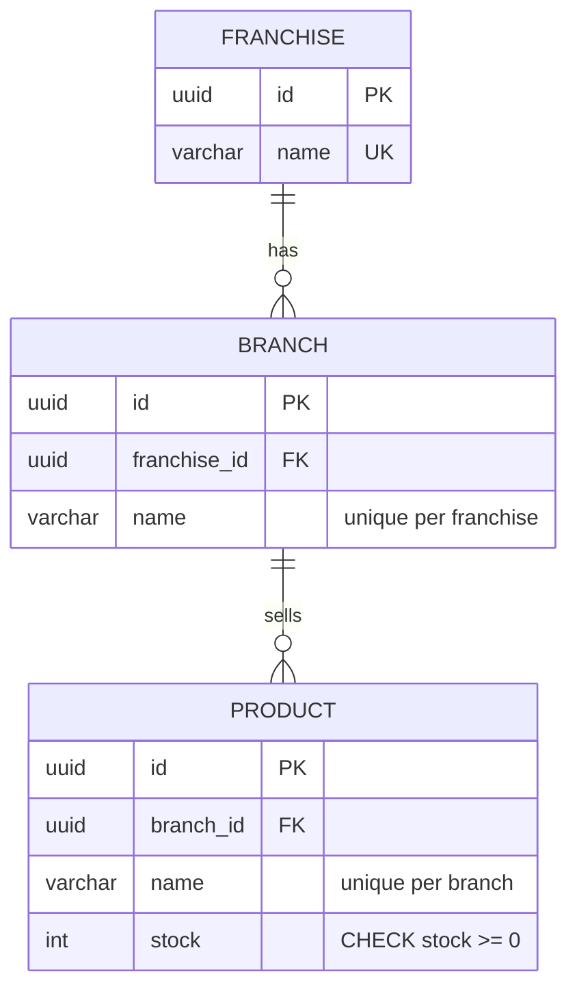

# Franchise API

Reactive REST API to manage a network of franchises, their branches and the stock of the products each branch sells.

Built with **Java 25**, **Spring Boot 4.1 / WebFlux**, **R2DBC + PostgreSQL** and the
[Bancolombia Clean Architecture scaffold](https://bancolombia.github.io/scaffold-clean-architecture/). The flow is
non-blocking end to end, from the HTTP server to the database driver, and the test suite runs with
[BlockHound](https://github.com/reactor/BlockHound) to prove it.

---

## Contents

- [Highlights](#highlights)
- [Architecture](#architecture)
- [API](#api)
- [Getting started](#getting-started)
- [Testing](#testing)
- [Configuration](#configuration)
- [Design notes](#design-notes)
- [Project structure](#project-structure)
- [Git workflow](#git-workflow)

---

## Highlights

- **Functional endpoints only**: `RouterFunction` + handlers, no `@RestController`. There is no `.block()`, no
  `try/catch` and no `if` inside reactive flows, and no `java.util.stream`.
- **Hexagonal architecture**: business rules live in the domain (`model` + `usecase`). Persistence and HTTP are
  adapters behind ports. The scaffold's `validateStructure` and ArchUnit rules enforce the dependency rule.
- **Consistency under concurrency**: every update touches a single column (`UPDATE ... RETURNING`), so there are no
  lost updates. Unique constraints back the "unique name per parent" rule even when two requests race.
- **Resilience**: timeout, circuit breaker and retry with exponential backoff (Resilience4j). Only idempotent operations
  are retried.
- **Secrets**: database credentials are read from AWS Secrets Manager reactively, once per new physical connection, so
  a rotated password is picked up without a restart. Nothing sensitive is stored in code or environment variables.
- **Errors as [RFC 9457](https://www.rfc-editor.org/rfc/rfc9457) problem details** (`application/problem+json`), with a
  stable error `code`.
- **111 tests, 99% line coverage**: unit (StepVerifier + Mockito), adapter integration and end-to-end tests against a
  real PostgreSQL (Testcontainers). `./gradlew check` fails if any module drops below 80% line coverage.

## Architecture


| Module | Layer | Responsibility |
|---|---|---|
| `domain/model` | Domain | Entities as immutable records built with Lombok `@Builder(toBuilder = true)`, repository ports, the sealed `DomainException` hierarchy and the `TechnicalMessage` catalogue. |
| `domain/usecase` | Domain | Business rules, written as reactive pipelines over the ports. |
| `infrastructure/entry-points/reactive-web` | Infrastructure | Routes, handlers, request records and validation, error translation, OpenAPI. |
| `infrastructure/driven-adapters/r2dbc-postgresql` | Infrastructure | R2DBC adapters, SQL schema, connection pool, Secrets Manager credentials. |
| `infrastructure/helpers/resilience` | Infrastructure | Timeout, circuit breaker and retry policies. |
| `applications/app-service` | Application | Spring Boot main class, configuration and wiring. |

### Data model



## API

Base path: `/api/v1`. Swagger UI is available at **`/swagger-ui.html`**, and the OpenAPI document at `/v3/api-docs`.
Every operation is documented there with request and response examples.

| # | Operation | Method & path | Success |
|---|---|---|---|
| 1 | Create a franchise | `POST /franchises` | `201` |
| 2 | Add a branch to a franchise | `POST /franchises/{franchiseId}/branches` | `201` |
| 3 | Add a product to a branch | `POST /franchises/{franchiseId}/branches/{branchId}/products` | `201` |
| 4 | Remove a product from a branch | `DELETE /franchises/{franchiseId}/branches/{branchId}/products/{productId}` | `204` |
| 5 | Set the stock of a product | `PUT /franchises/{franchiseId}/branches/{branchId}/products/{productId}/stock` | `200` |
| 6 | Product with the highest stock per branch | `GET /franchises/{franchiseId}/top-stock-products` | `200` |
| 7 | Rename a franchise | `PUT /franchises/{franchiseId}/name` | `200` |
| 8 | Rename a branch | `PUT /franchises/{franchiseId}/branches/{branchId}/name` | `200` |
| 9 | Rename a product | `PUT /franchises/{franchiseId}/branches/{branchId}/products/{productId}/name` | `200` |

Rules enforced by the domain:

- Names are required, at most 100 characters, and unique within their parent: franchise names are globally unique,
  branch names within a franchise, product names within a branch.
- Stock is an absolute value and must be zero or greater.
- Resources are addressed through their hierarchy. A product is only reachable through its own branch and franchise;
  otherwise the API answers `404`.
- `PUT` operations are idempotent. Renaming to the current name succeeds, and setting the same stock twice gives the
  same result.
- In `top-stock-products`, branches without products are omitted, and stock ties are broken by product name.

### Errors

Errors follow RFC 9457 and add a stable `code` and, for validation errors, the list of violated fields:

```json
{
  "title": "Bad Request",
  "status": 400,
  "detail": "The request is invalid, please verify the data",
  "instance": "/api/v1/franchises/.../products",
  "code": "FRN-400",
  "timestamp": "2026-10-09T01:41:50.001Z",
  "errors": [
    { "field": "name", "message": "must not be blank" },
    { "field": "stock", "message": "must be greater than or equal to 0" }
  ]
}
```

| HTTP | Codes | When |
|---|---|---|
| 400 | `FRN-400`, `FRN-401`, `FRN-402` | Malformed body or identifier, constraint violations, invalid name or stock |
| 404 | `FRN-404`, `FRN-405`, `FRN-406` | Franchise, branch or product not found in the given hierarchy |
| 409 | `FRN-409`, `FRN-410`, `FRN-411` | Name already taken in the parent |
| 503 | `FRN-503` | Database unavailable, timed out, or circuit open (safe to retry later) |
| 500 | `FRN-500` | Unexpected error; no internal details are exposed |

## Getting started

### Prerequisites

- **Option 1** needs only Docker (with Compose) or Podman (with a compose provider such as `podman-compose`).
- **Option 2** needs **JDK 25** plus Docker/Podman to run PostgreSQL. The Gradle wrapper downloads Gradle 9.8.1.

### Option 1: everything in containers

```bash
git clone https://github.com/emmanuelcastig/franchise-api.git
cd franchise-api
docker compose up --build        # or: podman compose up --build
```

The image is built from source (multi-stage `deployment/Dockerfile`). When the API logs `Started MainApplication`, it
is ready at <http://localhost:8080/swagger-ui.html>.

### Option 2: run with Gradle

```bash
# 1. Start PostgreSQL (credentials of a disposable local database)
docker run -d --name franchise-postgres -p 5432:5432 \
  -e POSTGRES_DB=franchise -e POSTGRES_USER=franchise -e POSTGRES_PASSWORD=franchise postgres:17-alpine

# 2. Run the API with the local profile
./gradlew :app-service:bootRun --args='--spring.profiles.active=local'      # Windows: gradlew.bat ...
```

The schema is created automatically on startup.

> If a local PostgreSQL already listens on 5432, publish the container on another port (`-p 5433:5432`) and start the
> API with `DB_PORT=5433`.

### Try it

```bash
BASE=http://localhost:8080/api/v1/franchises

# 1. Create a franchise
curl -s -X POST $BASE -H 'Content-Type: application/json' -d '{"name":"Burger Town"}'
# {"id":"<franchiseId>","name":"Burger Town"}

# 2. Add a branch
curl -s -X POST $BASE/<franchiseId>/branches -H 'Content-Type: application/json' -d '{"name":"Downtown"}'

# 3. Add a product
curl -s -X POST $BASE/<franchiseId>/branches/<branchId>/products \
  -H 'Content-Type: application/json' -d '{"name":"Fries","stock":50}'

# 5. Set the stock
curl -s -X PUT $BASE/<franchiseId>/branches/<branchId>/products/<productId>/stock \
  -H 'Content-Type: application/json' -d '{"stock":120}'

# 6. Top stock product per branch
curl -s $BASE/<franchiseId>/top-stock-products

# 4. Remove a product
curl -s -X DELETE $BASE/<franchiseId>/branches/<branchId>/products/<productId>
```

Health probes: `GET /actuator/health/liveness` and `GET /actuator/health/readiness`. Metrics: `GET /actuator/prometheus`.

## Testing

```bash
./gradlew test                 # every test
./gradlew check                # tests + 80% line coverage gate per module
./gradlew jacocoMergedReport   # merged report: build/reports/jacocoMergedReport/html/index.html
```

| Level | Where | What it proves |
|---|---|---|
| Unit | `domain/usecase` | Business scenarios with `StepVerifier` + Mockito: validation, hierarchy, uniqueness, idempotent rename, top-stock ranking, demand-driven streaming with 1,000 branches. |
| Unit | `helpers/resilience`, `r2dbc/commons` | Retries only on transient errors and only for idempotent calls, time limiter cancellation, circuit opening, error translation. |
| Slice | `reactive-web` | `@WebFluxTest` of every route: status codes, problem details, validation, CORS and security headers. |
| Integration | `r2dbc-postgresql` | Adapters against PostgreSQL 17 (Testcontainers): SQL, mappings, constraints, scoping, grouped streaming. |
| End-to-end | `app-service` | The whole service on a random port against PostgreSQL: the full lifecycle of a franchise, OpenAPI document, readiness probe. |
| Architecture | `app-service` | Scaffold ArchUnit rules (final fields, no technology names in the domain). |

Integration and end-to-end tests need a Docker-compatible runtime (Docker or Podman). Without one they are **skipped**,
not failed. No test uses `.block()`.

BlockHound is installed in every test JVM. A blocking call on a non-blocking thread fails the test (see
[what it caught](#what-blockhound-caught)).

## Configuration

| Variable | Description | Default |
|---|---|---|
| `SPRING_PROFILES_ACTIVE` | `local` uses static local credentials; any other profile reads them from Secrets Manager | `default` |
| `DB_HOST` / `DB_PORT` / `DB_NAME` | PostgreSQL location | `localhost` / `5432` / `franchise` |
| `DB_SSL_MODE` | R2DBC SSL mode (`disable` in the local profile) | `require` |
| `DB_SECRET_NAME` | Name of the Secrets Manager secret with `{"username","password"}` (e.g. the RDS-managed secret) | — |
| `AWS_REGION` | Region of Secrets Manager | `us-east-1` |
| `DB_CONNECT_TIMEOUT` / `DB_STATEMENT_TIMEOUT` | TCP connect timeout / server-side statement timeout | `5s` / `3s` |
| `DB_POOL_INITIAL_SIZE` / `DB_POOL_MAX_SIZE` | Connection pool size | `2` / `10` |
| `DB_POOL_MAX_IDLE_TIME` / `DB_POOL_MAX_LIFE_TIME` / `DB_POOL_MAX_ACQUIRE_TIME` | Pool connection lifecycle | `10m` / `30m` / `3s` |
| `DB_TIMEOUT` | Time limiter per database call | `2s` |
| `DB_CB_SLIDING_WINDOW_TYPE` / `DB_CB_SLIDING_WINDOW_SIZE` / `DB_CB_MIN_NUMBER_CALLS` | Circuit breaker window | `COUNT_BASED` / `20` / `10` |
| `DB_CB_FAILURE_RATE_THRESHOLD` / `DB_CB_SLOW_CALL_RATE_THRESHOLD` / `DB_CB_SLOW_CALL_DURATION_THRESHOLD` | Circuit breaker thresholds | `50` / `80` / `1s` |
| `DB_CB_WAIT_DURATION_OPEN_STATE` / `DB_CB_MAX_WAIT_DURATION_HALF_OPEN_STATE` / `DB_CB_PERMITTED_CALLS_HALF_OPEN_STATE` / `DB_CB_AUTO_TRANS_OPEN_TO_HALF_OPEN_STATE` | Circuit breaker state transitions | `15s` / `30s` / `3` / `true` |
| `DB_CB_IGNORE_EXCEPTIONS` | Exceptions that never count as failures | `DataIntegrityViolationException` |
| `DB_RETRY_MAX_ATTEMPTS` / `DB_RETRY_WAIT_DURATION` / `DB_RETRY_EXPONENTIAL_BACKOFF_MULTIPLIER` | Retry with exponential backoff | `3` / `100ms` / `2` |
| `DB_RETRY_EXCEPTIONS` | Exceptions that are retried | transient data access errors, `TimeoutException` |
| `SECRETS_CACHE_SECONDS` / `SECRETS_CACHE_SIZE` | Secrets Manager connector cache | `300` / `10` |
| `DB_INITIALIZE_SCHEMA` | Apply `db/schema.sql` on startup | `true` |
| `CORS_ALLOWED_ORIGINS` | Comma-separated allowed origins | `http://localhost:4200,http://localhost:8080` |
| `SWAGGER_UI_ENABLED` | Serve Swagger UI | `true` |
| `LOG_LEVEL_ROOT` / `LOG_LEVEL_APP` | Log level of the root logger / of `com.nequi.franchise` | `INFO` / `INFO` |
| `TRACING_SAMPLING_PROBABILITY` | Fraction of traces sampled | `0.1` |
| `DB_USERNAME` / `DB_PASSWORD` | **Local profile only**: credentials of the local database | `franchise` / `franchise` |

## Design notes

### Reactive end to end and backpressure

Reactor Netty reads requests and writes responses without blocking. Handlers return `Mono<ServerResponse>`, and the
R2DBC driver talks to PostgreSQL over non-blocking sockets. Backpressure is the Reactive Streams `request(n)` protocol:
a subscriber states how many elements it can take, and the publisher never emits more.

It matters most in the top-stock query. Rows stream from the database, and Reactor only requests more when downstream
operators are ready, so memory does not depend on how many products a franchise has. At the HTTP edge, Netty
propagates TCP backpressure: when the socket is not writable, demand stops flowing upstream. A test checks that only
the requested number of results is produced (`StepVerifier.create(flux, 2)` … `thenRequest(3)`).

### Product with the highest stock per branch

```java
franchiseRepository.findById(franchiseId)
        .switchIfEmpty(Mono.error(() -> new BusinessException(FRANCHISE_NOT_FOUND)))
        .flatMapMany(franchise -> productRepository.findStocksGroupedByBranch(franchise.id()))
        .windowUntilChanged(BranchProductStock::branchId)
        .concatMap(branchStocks -> branchStocks.reduce(BranchProductStock::higherRanked));
```

The port guarantees that rows of the same branch are contiguous (`ORDER BY b.name, b.id`). `windowUntilChanged` closes
each window as soon as the branch changes, and `reduce` keeps a single candidate, so memory is constant.
`groupBy` + `flatMap` was rejected on purpose: groups only complete when the whole source completes, so with more than
256 branches (the default `flatMap` concurrency) the pipeline stalls. A test with 1,000 branches covers this. The
ranking rule (highest stock, ties broken by name) lives in the domain record, not in SQL.

### Error handling without try/catch

Domain errors are a `sealed` hierarchy (`DomainException` permits `BusinessException` and `TechnicalException`).
Adapters translate persistence errors with `onErrorMap`, an anti-corruption layer that keeps Spring Data, R2DBC and
Resilience4j exceptions out of the domain. A single `HandlerFilterFunction` (the functional equivalent of an aspect
around handlers) turns error signals into problem responses with `onErrorResume`. An exhaustive `switch` maps the
transport-agnostic `ErrorType` to HTTP statuses.

### Consistency and concurrency

- **No read-modify-write of whole rows**: renaming and setting the stock each run one targeted
  `UPDATE ... RETURNING`, so a concurrent stock change can never overwrite a rename.
- **Uniqueness**: the use case checks the name first, which gives a precise error and keeps the rule visible in the
  domain. The database `UNIQUE` constraint is the race-free guarantee; if two requests pass the check at the same
  time, the constraint rejects one and the adapter maps it to the same `409`.
- **Idempotency**: stock is an absolute value, `PUT` is idempotent, and renaming to the current name is a no-op
  success. This is what makes retries safe.

### Resilience

Every database call goes through `ResiliencePolicy`. The operators are composed as
`Retry( CircuitBreaker( TimeLimiter( call ) ) )`:

- **Timeout**: 2 s per attempt (time limiter). A server-side `statement_timeout` of 3 s also stops queries that keep
  running after the client gave up.
- **Circuit breaker**: opens at a 50% failure rate or 80% slow calls over 20 calls, and fails fast with `503` while
  open. Constraint violations are ignored because they are business outcomes, not failures. It uses the
  **lock-free** sliding window (see below).
- **Retry**: 3 attempts with exponential backoff (100 ms, 200 ms), only for transient errors (connection failures,
  timeouts). Never for an open circuit or a business error.
- **What is retried**: reads, single-column updates and deletes only. **Inserts are not retried**, because a timeout
  does not mean the row was not written. **Streams are not retried** either, because re-subscribing after a partial
  emission would duplicate elements.

Every threshold and timeout can be tuned per environment through variables (see [Configuration](#configuration)).

### Secrets and credential rotation

```java
PostgresqlConnectionConfiguration.builder()
        .username(credentials.map(DatabaseCredentials::username))
        .password(credentials.<CharSequence>map(DatabaseCredentials::password))
```

The R2DBC driver accepts **publishers** for username and password and subscribes once per new physical connection.
The publisher defers to Bancolombia's async Secrets Manager connector, which caches the secret for 5 minutes.
Combined with a 30-minute maximum connection lifetime in the pool, a rotated RDS password is picked up without a
restart, and no secret is read or blocked on while the application starts. In AWS the connector authenticates with
the ECS task role. The only configuration is the secret *name*.

### What BlockHound caught

Running the suite with BlockHound surfaced four real blocking calls on event-loop threads. All four are fixed:

1. **Resilience4j circuit breaker**: the default sliding window guards its counters with a `ReentrantLock`, which
   parks Netty threads under contention. Fixed by switching to the `LOCK_FREE` synchronization strategy.
2. **Hibernate Validator**: it loads its message bundles from the jar the first time a constraint fails. Fixed by
   warming the validator up at startup.
3. **Spring Boot SQL initializer**: it streams `schema.sql` from the jar on the thread that obtained the connection.
   Fixed by loading the script bytes on the main thread (`SchemaInitializerConfig`).
4. **springdoc**: it scans the classpath on the first `/v3/api-docs` request. Fixed with
   `springdoc.pre-loading-enabled=true`.

### Logs and correlation

Logs are JSON documents (logstash encoder) with the team's message convention:

- Handlers log `<Operation> Handler [REQUEST]` and `[RESPONSE]`. The error filter logs `[BUSINESS ERROR]`,
  `[TECHNICAL ERROR]`, `[INVALID REQUEST]` and `[UNEXPECTED ERROR]`.
- Adapters log `<Operation> [REQUEST]`, `[RESPONSE]` and `[ERROR]` through `doOnSubscribe`, `doOnSuccess` and
  `doOnError`.
- Resilience4j events are logged too: `Circuit Breaker [STATE TRANSITION]`, `[CALL NOT PERMITTED]`,
  `Retry [ATTEMPT]`, `Retry [EXHAUSTED]` and `Time Limiter [TIMEOUT]`.

Payloads travel as structured fields (`kv(...)`), not inside the message text. `password` and `username` are masked.

Every request carries an `x-message-id`: the client's value, or a generated UUID if it is missing. The id is
returned in the response header and propagated as Micrometer Tracing baggage. With Reactor's automatic context
propagation (`spring.reactor.context-propagation=auto`), it reaches the MDC on every thread the request hops through,
so all its lines share `x-message-id` and `traceId`:

```json
{"message":"Save Franchise [RESPONSE]","thread_name":"reactor-tcp-nio-1","x-message-id":"65f9d3a5-…","traceId":"35824d07…","response":{"id":"b2c3…","name":"Pizza Town"}}
```

Log levels are configurable with `LOG_LEVEL_ROOT` and `LOG_LEVEL_APP`, and trace sampling with
`TRACING_SAMPLING_PROBABILITY`.

### Container image

The multi-stage `deployment/Dockerfile` compiles inside a JDK image, extracts Spring Boot layers so dependencies are
cached apart from application code, and runs as a non-root user on a JRE. A training run builds a **JDK 25 AOT cache**
(JEP 514/515), which speeds up the startup of tasks added by auto scaling.

### Deployment (AWS)

The deployment uses ECR, ECS Fargate behind an ALB with auto scaling, RDS PostgreSQL with an RDS-managed secret in
Secrets Manager, and least-privilege IAM roles. It is provisioned with modular Terraform and lives in `iac/`.

## Project structure

```
├── applications/app-service          # Spring Boot application, configuration, end-to-end tests
├── domain
│   ├── model                         # entities, ports, exceptions, error catalogue
│   └── usecase                       # business rules
├── infrastructure
│   ├── driven-adapters/r2dbc-postgresql
│   ├── entry-points/reactive-web
│   └── helpers/resilience
├── deployment/Dockerfile
└── compose.yaml
```

## Git workflow

GitFlow: `main` holds released versions, `develop` integrates finished work, and every change is developed on a
`feature/*` branch merged into `develop` with `--no-ff`. Commit messages follow
[Conventional Commits](https://www.conventionalcommits.org/).
